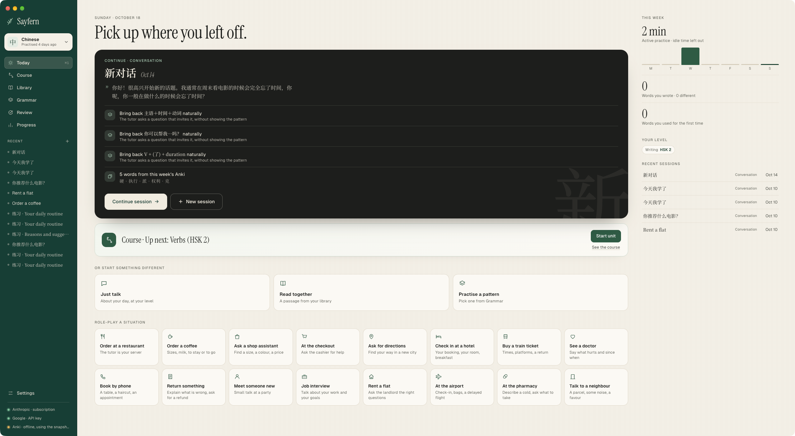

<div align="center">


# Sayfern

**Conversational language learning for free. An AI tutor that remembers what you're learning.**

[](https://github.com/yufengliu15/Sayfern/releases)
[](https://github.com/yufengliu15/Sayfern/actions/workflows/release.yml)
[](LICENSE)


[Website](https://sayfern.ca) · [Download](https://github.com/yufengliu15/Sayfern/releases) · [User guide](docs/guide.md) · [Changelog](CHANGELOG.md)



</div>

Sayfern is a desktop app where you learn a language by chatting with an AI tutor. The tutor corrects you like a teacher, keeps track of your grammar, words and level, and picks up where you left off. You bring your own model: a Claude Pro/Max or ChatGPT subscription, an API key, or a local model. All your records stay on your computer as plain JSON files.

**Version:** 0.31.1 ([changelog](CHANGELOG.md))

## Features

- **11 learning languages:** Chinese, Japanese, Korean, English, Spanish, French, German, Italian, Portuguese, Russian and Vietnamese. Courses for nine of them (HSK 3.0, JLPT, TOPIK, English Grammar Profile, CEFR); Russian and Vietnamese are in Beta.
- **13 interface languages.** The app follows your system language, and the tutor explains in it.
- **Remembers you.** Corrections, grammar points, words and level estimates are stored after every turn. Every number you see is computed on your computer, not by the model.
- **Corrections review and quizzes** built from your own mistakes, graded locally where possible.
- **Anki integration** through AnkiConnect: the tutor keeps to words you know, turns corrections into cards, and can generate new decks with readings and audio.
- **Voice:** listen to the tutor and talk instead of typing (ElevenLabs or free voices).
- **Role-play scenarios, New topic and a difficulty slider** to keep conversations fresh.
- **Many model providers:** Anthropic, OpenAI, OpenRouter, DeepSeek, Google, OpenCode, and local models through llama.cpp. Each provider shows its usage and limits.
- **Light on your plan:** in our [benchmark](https://sayfern.ca/#benchmark), Sayfern uses about 3× less of your Claude plan limit than Claude Code with a tutoring skill ([method](docs/benchmark.md)).

## Who it is for

Sayfern takes learners **from 1 to infinity**: people who already know some of a language and want to go much further through real conversation. It does not try to replace a first course (0 to 1). Beginners are still welcome: they can write in their own language when they lack the words, and the tutor shows them how to say it.

## Install

Download the installer for your system from the [releases page](https://github.com/yufengliu15/Sayfern/releases):

| System | File |
|---|---|
| macOS | `.dmg` |
| Windows | `.exe` |
| Linux | `.flatpak` or `.tar.gz` |

> [!NOTE]
> The installers are not signed with a paid certificate yet. On macOS, right-click the app and click **Open** the first time. On Windows, click **More info**, then **Run anyway**.

Sayfern checks for new versions in **Settings > Preferences > Updates** (and **Sayfern > Check for Updates** on macOS).

### Build from source

Needs [Node.js](https://nodejs.org/) 22.19 or later.

```bash
git clone https://github.com/yufengliu15/Sayfern.git
cd Sayfern
npm install
npm run dev
```

To build an installer, run `npm run dist -- --mac --arm64` (or `--win`, `--linux`). See [`docs/packaging.md`](docs/packaging.md).

## Getting started

1. Open Sayfern. The welcome page asks you to connect one model provider.
2. Pick the languages you learn and your level, or take a short placement chat.
3. Optionally link Anki (needs the [AnkiConnect](https://ankiweb.net/shared/info/2055492159) add-on).
4. Start a chat on **Today**.

Providers, local models, dictionaries, Anki, quizzes and data export are in the [user guide](docs/guide.md).

## Documentation

| Document | What it covers |
|---|---|
| [`docs/guide.md`](docs/guide.md) | Set up and use the app |
| [`docs/local-models.md`](docs/local-models.md) | Run a local model with llama.cpp |
| [`AGENTS.md`](AGENTS.md) | Start here to change the code (for people and coding agents) |
| [`docs/architecture.md`](docs/architecture.md) | How everything fits together, module by module |
| [`docs/decisions.md`](docs/decisions.md) | Why it is built this way |
| [`docs/courses.md`](docs/courses.md) | How to write a language's course |
| [`docs/roadmap.md`](docs/roadmap.md) | What comes next, and known gaps |
| [`docs/stage1.md`](docs/stage1.md), [`stage2.md`](docs/stage2.md), [`stage3.md`](docs/stage3.md) | Feature status |
| [`docs/benchmark.md`](docs/benchmark.md) | Benchmark against Claude Code with a skill |

## Development

Sayfern is an Electron app with a React UI. All logic lives in plain Node in `src/core`, so you can test it without the UI.

```bash
npm run typecheck                          # both TypeScript projects
npm test                                   # unit and integration tests, no network
npm run smoke -- selftest                  # offline end-to-end check with a fake provider
npm run smoke -- login anthropic           # or: login openai, or: key <provider> <api-key>
npm run smoke -- chat anthropic "你好！"   # real provider from the terminal
npm run smoke -- models anthropic          # list a provider's models
npm run bench -- run                       # benchmark against Claude Code with a skill
npx vite --config vite.mock.config.ts      # UI only, in a browser, with a mock backend
```

The smoke script uses its own data and plain-text credentials in `./.sayfern-dev/` (gitignored). The repo layout, contracts and rules are in [`AGENTS.md`](AGENTS.md).

## Contributing

Bug reports and ideas are welcome in [GitHub Issues](https://github.com/yufengliu15/Sayfern/issues). Before you open a pull request, read [`AGENTS.md`](AGENTS.md), and make sure `npm run typecheck` and `npm test` pass. Translations of the interface live in `src/shared/i18n/`.

## Acknowledgements

- [`@earendil-works/pi-ai`](https://github.com/badlogic/pi-mono/tree/main/packages/ai) for model providers, sign-in and streaming.
- Dictionaries: [CC-CEDICT](https://cc-cedict.org/), [JMdict](https://www.edrdg.org/jmdict/j_jmdict.html), Kengdic, [WikDict](https://www.wikdict.com/), [Open English WordNet](https://en-word.net/) and [kaikki.org](https://kaikki.org/) (Wiktionary).
- [kuromoji](https://github.com/takuyaa/kuromoji.js), [pinyin-pro](https://github.com/zh-lx/pinyin-pro), [pdf.js](https://github.com/mozilla/pdf.js), [Electron](https://www.electronjs.org/) and [React](https://react.dev/).

## License

Copyright (C) 2026 Yufeng Liu

Sayfern is free software under the [GNU General Public License v3.0](LICENSE) (`GPL-3.0-only`). You can use, study, share and change it. If you distribute a modified version, it must stay under the same licence with its source available.
